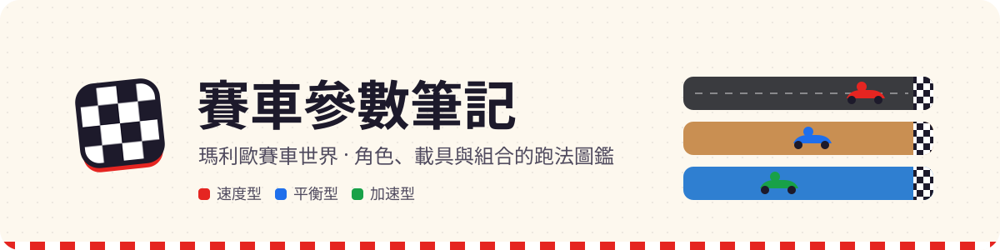
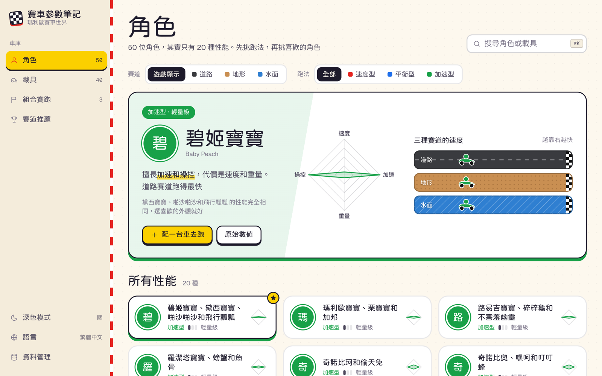
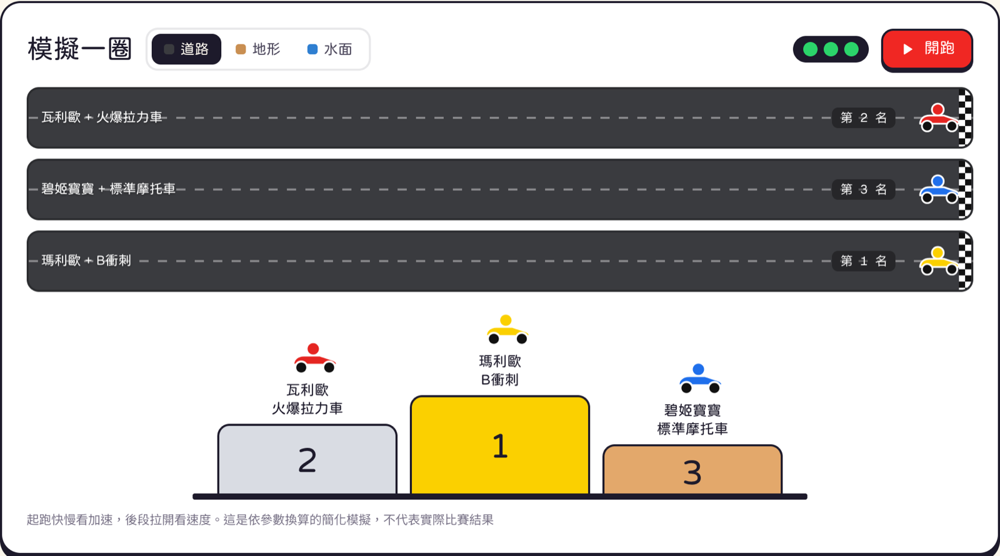
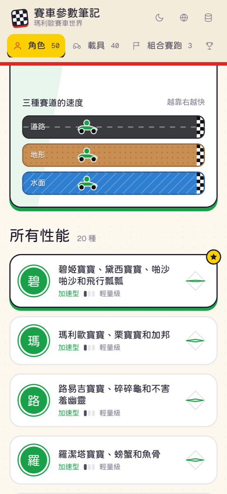
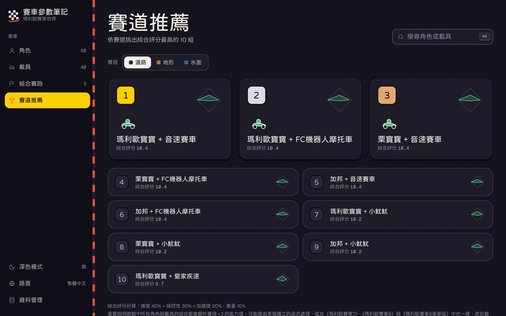

<p align="center">
  
</p>

<p align="center">
  先挑跑法，再挑喜歡的角色。<br />
  把瑪利歐賽車世界的角色、載具與組合，從一堆數字變成看得懂的跑法圖鑑。
</p>

<p align="center">
  <a href="#起跑前">起跑前</a> ·
  <a href="#賽道導覽">賽道導覽</a> ·
  <a href="#引擎室">引擎室</a> ·
  <a href="#車庫地圖">車庫地圖</a> ·
  <a href="#維修站">維修站</a>
</p>

---

## 先看一圈



| 組合賽跑 | 手機版 |
| --- | --- |
|  |  |



## 賽道導覽

### 角色與載具

- **性能分組**：數值完全相同的角色／載具合併成一張卡片，50 位角色其實只有 20 種性能
- **跑法顏色**：<kbd>🟥 速度型</kbd> <kbd>🟦 平衡型</kbd> <kbd>🟩 加速型</kbd>，再標上輕／中／重量級
- **焦點區**：雷達圖看能力輪廓，一句話說出強項與代價，三條賽道上的卡丁車越靠右代表該地形越快
- **一鍵配車**：在焦點區按「配一台車去跑」，直接帶著這位角色到組合賽跑

### 組合賽跑

- 挑角色 + 載具加入賽局，紅綠燈 3 · 2 · 1 · GO 後模擬跑一圈
- 起跑快慢看加速，後段拉開看速度；跑完上頒獎台
- 每張組合卡片標出「哪一項最強／最弱」與最適合的賽道

### 賽道推薦

- 依道路／地形／水面挑出綜合評分最高的 10 組，前三名用金銀銅標示
- 綜合評分 = 速度 × 40% + 操控 × 30% + 加速 × 20% − 重量 × 10%（以整數運算，結果穩定可重現）

### 隨手可用

- **搜尋**：<kbd>⌘K</kbd> / <kbd>Ctrl</kbd> <kbd>K</kbd>，中英文名稱、前綴與模糊比對，點結果直接跳到焦點區
- **五種語言**：繁中、簡中、English、日本語、한국어，切換免重新載入
- **深色模式**：所有顏色都是 CSS 變數 token，亮暗共用同一套元件
- **手機版**：頂部導覽固定在畫面上；點卡片會自動捲到焦點區，不用再往上滑
- **本機保存**：組合、語言、主題與搜尋紀錄存在這台裝置，不會上傳

## 起跑前

需要 Node.js 18+（執行 `pnpm test` 需要 22.18+）與 pnpm 8+。

```bash
git clone https://github.com/Ponpon55837/MarioKartWorldParams.git
```

```bash
cd MarioKartWorldParams && pnpm install
```

```bash
pnpm dev
```

開啟 http://localhost:3000 就能開跑。

| 指令 | 用途 |
| --- | --- |
| `pnpm dev` | 開發伺服器 |
| `pnpm build` / `pnpm start` | 建置與啟動正式版 |
| `pnpm lint` | ESLint |
| `pnpm type-check` | TypeScript 型別檢查 |
| `pnpm test` | 演算法與工具函數測試（`node:test`，無額外依賴） |

### 環境變數（資料同步用）

| 變數 | 說明 |
| --- | --- |
| `GOOGLE_SHEETS_CSV_URL` | Google Sheets CSV 匯出網址，未設定時同步 API 回傳錯誤 |
| `SYNC_SECRET_TOKEN` | 正式環境呼叫 `POST /api/sync-data` 需帶 `Authorization: Bearer <token>`（管理頁可直接輸入，不會儲存）；開發環境略過驗證 |
| `NEXT_PUBLIC_JOTAI_DEVTOOLS` | 設為 `true` 才在開發環境載入 Jotai DevTools |

## 引擎室

核心計算都是 `src/utils/` 下的純函數，由 Jotai 衍生 atom 呼叫（依賴不變就沿用快取），並在 `tests/` 以暴力解（Oracle）驗證結果完全一致。

| 功能 | 做法（LeetCode 對應） | 複雜度 |
| --- | --- | --- |
| 推薦組合 | 評分拆成「角色分 + 載具分」，各自排序後以堆積做 K 路合併（23 / 373） | O(C log C + V log V + (V+K) log V)，原為 O(C·V log(C·V)) |
| 組合最大值 | max(c + v) = max(c) + max(v) | O(C + V)，原為 O(C·V) |
| 性能分組 | 能力值簽章 + Hash Map 分組（49 Group Anagrams） | O(n·k)，原為兩兩比較 O(n²·k) |
| 組合強弱 | 每欄單次走訪記錄最大／最小值與次數 | O(n·k)，原為 O(n²·k) |
| 賽跑模擬 | 位置封閉解 p(t) = v·t − (v/a)(1 − e^(−a·t))，二分搜尋完賽時間 | 每幀 O(1)，完賽時間 O(log(1/ε)) |
| 搜尋 | 預建小寫索引 + 堆積 Top-K（347） | O(n log K) |
| CSV 解析 | 雙指標 + slice，支援引號跳脫與 CRLF | O(n) |
| 資料驗證 | Set 偵測重複（217） | O(n) |
| 資料載入 | 進行中請求去重，多個元件同時觸發只發一次請求 | — |

實測（Node.js 25）：真實資料 50 角色 × 40 載具，三地形推薦約 **1.8 ms → 0.1 ms**；500 × 500 時約 **400 ms → 1.6 ms**。

渲染層面：頁面框架只訂閱載入狀態與目前頁面，隱藏頁面的衍生資料不會被計算；性能卡片與組合卡片以穩定 callback 搭配 `React.memo`；賽跑動畫透過 ref 直接更新 `transform`，每一幀都不重新渲染。

## 車庫地圖

| 類別 | 使用 |
| --- | --- |
| 框架 | Next.js 16.3.6（App Router）、React 18.3.1、TypeScript 5.9.3 |
| 狀態 | Jotai 2.20.3（原始／衍生／action atoms + localStorage 持久化） |
| 樣式 | Tailwind CSS 3.4.19 + CSS 變數 token |
| 字體 | 粉圓 Huninn（標題）、Geist + Noto Sans TC（內文）、Geist Mono（數字） |
| 多國語系 | react-i18next 15.7.4、i18next-browser-languagedetector 8.2.0 |
| 工具 | pnpm、`node:test` |

```
src/
├── app/                          # Next.js App Router
│   ├── admin/page.tsx            # 資料同步管理頁
│   ├── api/sync-data/route.ts    # Google Sheets 同步 API（含驗證）
│   ├── icon.svg / apple-icon.png # favicon 與 Apple touch icon
│   ├── globals.css               # 設計 token 與賽道材質
│   ├── layout.tsx                # 根版面與字體
│   └── page.tsx                  # 首頁
├── components/
│   ├── layout/                   # 側邊欄（手機版為固定頂部列）、應用程式框架
│   ├── ui/                       # Button、Segmented、Avatar、Icon
│   ├── profile/                  # 雷達圖、卡丁車、賽道、焦點區、性能卡片
│   ├── browser/                  # 角色／載具瀏覽頁
│   ├── combos/                   # 組合建立器、賽跑、頒獎台、組合卡片
│   ├── admin/                    # 管理頁面板
│   ├── search/                   # 搜尋視窗子元件
│   ├── RecommendationsPage.tsx   # 賽道推薦
│   └── SearchModal.tsx           # ⌘K / Ctrl+K 搜尋
├── constants/                    # 跑法色彩、賽道材質、獎牌色
├── hooks/                        # useMarioKartStore、useRaceAnimation、useListFormat…
├── i18n/                         # 5 種語言
├── providers/JotaiProvider.tsx
├── store/                        # dataAtoms.ts、combinations.ts
├── types/index.ts                # 型別（STAT_KEYS 為能力值欄位單一來源）
└── utils/                        # 純函數：stats、profile、race、heap、recommendation、search、csvParser…
tests/
├── algorithms.test.mts           # 推薦、搜尋、解析等（暴力解 Oracle + 隨機測試）
├── profile.test.mts              # 性能分組、跑法、強弱項
├── race.test.mts                 # 完賽時間與逐步模擬比對、排名
└── helpers.mts                   # 真實資料與隨機資料產生器
```

### 資料

資料來自 `public/mario-kart-data.csv` 與 `public/mario-kart-data.json`：角色與載具各有速度、加速、重量、操控，以及道路／地形／水面的分項數值。組合數值 = 角色 + 載具 + 3 點遊戲加成（理論最大值 20）。

## 設計

- **原則**：參考 [unslop](https://github.com/heydamir/unslop)，外框保持安靜，色彩與動態集中在焦點區與組合賽跑兩個重點
- **色彩意義**：紅／藍／綠代表速度型／平衡型／加速型；深灰、土黃、藍色代表道路、地形、水面
- **遊戲感**：格旗標誌、紅白賽道邊線、按下會下沉的按鈕、紅綠燈倒數與頒獎台
- **無障礙**：所有控制項可用鍵盤操作，分段選擇器支援方向鍵，尊重 `prefers-reduced-motion`

## 維修站

### 開發規範

- 不在 `main` 直接修改；分支命名 `<type>/<name>/<description>`，commit 使用 Conventional Commits
- 演算法放在 `src/utils` 的純函數，並附暴力解 Oracle 測試
- 所有畫面文字都要同步 5 種語言
- 修改後依序跑 `type-check` / `lint` / `test` / `build`

### Agent Skills

OpenCode（`.opencode/skills/`）與 GitHub Copilot（`.github/skills/`）以符號連結共用同一套技能，修改一次兩邊同步：

| Skill | 內容 |
| --- | --- |
| `git-workflow` | 分支命名與工作流程 |
| `code-standards` | Next.js App Router、TypeScript、Jotai、Tailwind 規範與驗證步驟 |
| `i18n-workflow` | 五語言翻譯流程 |
| `algorithm-patterns` | 專案中的 LeetCode 式演算法與 Oracle 測試流程 |
| `state-management` | Jotai atoms 分類與載入去重 |
| `readme-maintenance` | README 與專案狀態同步 |
| `react-best-practices` | Vercel Engineering 的 React / Next.js 效能規則 |
| `web-design-guidelines` | 無障礙、焦點、動畫、排版等 UI 檢查 |
| `react-table-search-pagination` | 表格搜尋、分頁與競態處理範本（僅 OpenCode） |

### 已知狀況

- `pnpm build` 會出現一次 `Failed to find font override values for font Huninn`：Google 沒有提供粉圓的字體度量值，只代表標題不產生 fallback 字體，不影響畫面
- Next.js 16 已移除 `next lint`，`pnpm lint` 直接執行 ESLint CLI
- Vercel Speed Insights 只在正式環境載入
- Vercel 等無伺服器環境的檔案系統為唯讀，同步時不會寫入 `public/mario-kart-data.json`；管理頁會提示改為下載 JSON 後提交到 repo

快取出問題時：

```bash
rm -rf .next && pnpm dev
```

### 隱私

組合與偏好只存在瀏覽器本機；唯一的伺服器端點是受 token 保護的資料同步 API，寫入前會完整驗證，不收集任何個人資料。

## 終點線

- 問題回報：[Issues](https://github.com/Ponpon55837/MarioKartWorldParams/issues)
- 想法討論：[Discussions](https://github.com/Ponpon55837/MarioKartWorldParams/discussions)
- [貢獻指南](./openspec/CONTRIBUTING.md) · [Roadmap](./openspec/ROADMAP.md) · [部署指南](./openspec/DEPLOYMENT.md)

本專案採用 MIT 授權。瑪利歐賽車相關名稱與資料版權屬於 Nintendo，感謝玩家社群整理的參數資料。
